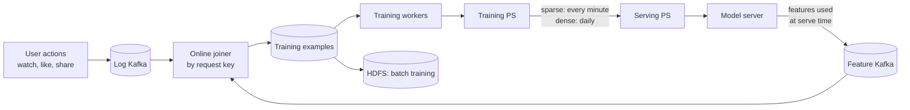
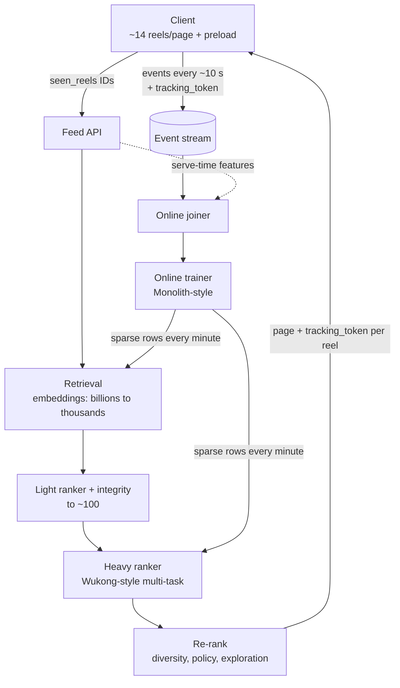

+++
title = "What Reel You Will Get Next"
date = "2026-10-22T20:00:00+05:30"
description = "A system design walkthrough of a real-time short-video recommender, built from what we saw Instagram's web app send, ByteDance's Monolith paper and Meta's Wukong paper."
tags = ["blog","system-design","recommendation-systems","instagram","notes"]
+++

We watched what **instagram.com** sends while you scroll Reels. Then we liked one panda video. The next batch was full of animals, and pandas kept landing in the top slot.

How does a system learn that in about 80 seconds? Let's design it from scratch, using three things:

1. **What we observed** in the browser (our experiments, desktop web, one account)
2. **Monolith**: ByteDance's paper on real-time training
3. **Wukong**: Meta's paper on scaling ranking models

> **Ground rule.** Instagram's ranking runs on Meta's servers, so we can't see it. Every claim here is labelled **observed** (we saw it in network traffic), **Meta says** (public docs) or **paper** (Monolith or Wukong). Monolith is ByteDance's system, not Instagram's, and Meta has never said Reels runs Wukong. We use both as reference designs.

## 1. What the client actually does (observed)

| What | What we saw |
|---|---|
| Feed delivery | One GraphQL call returns **~14 reels**. No request per swipe |
| Preloading | Videos for upcoming reels start downloading before you reach them |
| Event log | `logging_client_events`, batched **every ~10 s**, ~240 events in 4 min |
| Per-reel signal | `video_exited` carries the exact second you left, the reel length and the loop count |
| The join key | Each reel arrives with a `tracking_token`. Every event about that reel sends it back (**73/73 matched**) |
| Next-page request | Sends only the IDs of `seen_reels`. Watch time travels separately in the event log |
| Third parties | None. Everything went to Instagram/Meta domains |

So the whole system is a loop:

<svg viewBox="0 0 700 230" role="img" aria-label="Feedback loop: you scroll, events are logged, joined, trained on and ranked, and the next page comes back to you">
<path id="fwd" class="wire" d="M130,67 L570,67"/>
<path id="back" class="wire" d="M630,94 C630,215 70,215 70,94"/>
<circle class="dot1" r="6"><animateMotion dur="3s" repeatCount="indefinite"><mpath href="#fwd"/></animateMotion></circle>
<circle class="dot1" r="6"><animateMotion dur="3s" begin="1s" repeatCount="indefinite"><mpath href="#fwd"/></animateMotion></circle>
<circle class="dot1" r="6"><animateMotion dur="3s" begin="2s" repeatCount="indefinite"><mpath href="#fwd"/></animateMotion></circle>
<circle class="dot2" r="7"><animateMotion dur="4s" repeatCount="indefinite"><mpath href="#back"/></animateMotion></circle>
<rect class="box" x="10" y="40" width="120" height="54" rx="10"/><text class="lbl" x="70" y="64" text-anchor="middle">You scroll</text><text class="sub" x="70" y="80" text-anchor="middle">watch, skip, loop</text>
<rect class="box" x="150" y="40" width="120" height="54" rx="10"/><text class="lbl" x="210" y="64" text-anchor="middle">Event log</text><text class="sub" x="210" y="80" text-anchor="middle">every ~10 s</text>
<rect class="box" x="290" y="40" width="120" height="54" rx="10"/><text class="lbl" x="350" y="64" text-anchor="middle">Joiner</text><text class="sub" x="350" y="80" text-anchor="middle">by tracking_token</text>
<rect class="box" x="430" y="40" width="120" height="54" rx="10"/><text class="lbl" x="490" y="64" text-anchor="middle">Trainer</text><text class="sub" x="490" y="80" text-anchor="middle">online updates</text>
<rect class="box" x="570" y="40" width="120" height="54" rx="10"/><text class="lbl" x="630" y="64" text-anchor="middle">Ranker</text><text class="sub" x="630" y="80" text-anchor="middle">scores candidates</text>
<text class="sub" x="350" y="200" text-anchor="middle">next page: ~14 reels, each stamped with a tracking_token</text>
<text class="sub" x="350" y="20" text-anchor="middle">blue = your signals going up · orange = the next batch coming down</text>
</svg>

The loop. "You scroll", "Event log" and the returning page are observed. Joiner, trainer and ranker live on Meta's servers: that part is our design, not something we saw.

## 2. Requirements

- **Functional:** given a user, return the next page of ~14 reels, ordered by how likely they are to engage.
- **Fresh:** a new interest should show up within a page or two, not tomorrow.
- **Scale:** billions of reels and users. New IDs appear and old ones die every minute.
- **Latency:** a page must be ready before you hit the end of the current one. Preloading hides the rest.

## 3. High-level design: the funnel (Meta says)

Meta's system card for **Reels Chaining** lists four stages: gather inventory, use signals to pick about 100, predict, then rank by score. Every reel we captured carried `inventory_source: "recommended_clips_chaining_model"`, which matches that name.

Billions of reels <small>(Meta AI blog)</small>

Thousands of candidates <small>(retrieval)</small>

~100 <small>(light model + integrity checks)</small>

~14 per page <small>(observed)</small>

Cheap models shrink the list, so the expensive model only scores ~100 reels.

Why a funnel? Running the big model on billions of reels for every request would be far too slow. Each stage is cheaper than the next and hands over a shorter list.

The hard parts aren't the boxes. They're two properties of the data, both named in the Monolith paper.

## 4. Problem 1: the features are sparse IDs

Features are what the model looks at for one (you, reel) pair: your user ID, the reel ID, the creator ID, the audio ID, your city, the hour. Almost all of them are **IDs**. Each ID becomes a learned vector (an *embedding*) stored in a giant table.

The usual shortcut is to hash IDs into a fixed-size table. Then two reels can land in the same slot and share one vector, and popular IDs make those collisions hurt more.

**Monolith's fix (paper):**
- A **collisionless hash table** (cuckoo hashing). Every ID gets its own vector, and lookups are O(1).
- **Frequency filter:** an ID only gets a slot after it appears a few times. Rare IDs would be undertrained anyway.
- **Expiry:** IDs unused for a set period are evicted, so dead reels and inactive users stop eating memory.

## 5. Problem 2: interests drift by the minute (concept drift)

The pattern in the data keeps changing. Cricket during the IPL. Diwali reels in October. Pandas, right after you like one. A model trained yesterday is already stale.

**Monolith's answer (paper): train online, sync often.**

- **Joiner.** Features are logged when a reel is served. Actions arrive later, sometimes days later. Both carry a request key, so they can be paired. Recent ones wait in memory, older ones on disk. *Our `tracking_token` (73/73 matched) is exactly the kind of key such a joiner needs. That's an inference: we can't see Meta's joiner.*
- **Negative sampling.** Skips vastly outnumber likes, so negatives are sampled down. A log-odds correction at serving time undoes the bias.
- **Cheap sync.** In a short window only a few IDs get touched, so only those embedding rows are pushed, every minute. The paper's example: 100,000 IDs × 1024 dims ≈ 400 MB per minute. Dense weights move slowly, so they sync daily.
- **Reliability trade.** Snapshots happen once a day. Losing up to a day of updates hurt surprisingly little.
- **Payoff (paper).** A 30-minute sync beat 1-hour and 5-hour syncs. In a live A/B test on an ads model, online training beat batch training on AUC every day for a week.

### Does Instagram behave like this? Our panda run (observed)

<svg viewBox="0 0 640 250" role="img" aria-label="Bar chart: panda and animal reels per feed page. Zero before page 4, a burst of 9 animal reels on page 5, pandas on most pages after.">
<line class="grid" x1="50" x2="620" y1="210" y2="210"/><line class="grid" x1="50" x2="620" y1="110" y2="110" stroke-dasharray="2 4"/><line class="grid" x1="50" x2="620" y1="10" y2="10" stroke-dasharray="2 4"/>
<text class="tick" x="42" y="214" text-anchor="end">0</text><text class="tick" x="42" y="114" text-anchor="end">5</text><text class="tick" x="42" y="14" text-anchor="end">10</text>
<line class="event" x1="310" x2="310" y1="10" y2="210"/><text class="sub" x="304" y="24" text-anchor="end">first like + share →</text>
<text class="tick" x="76" y="228" text-anchor="middle">0</text>
<text class="tick" x="128" y="228" text-anchor="middle">1</text>
<text class="tick" x="180" y="228" text-anchor="middle">2</text>
<text class="tick" x="232" y="228" text-anchor="middle">3</text>
<rect class="bar s1" style="animation-delay:0.32s" x="267" y="190" width="16" height="20" rx="3"><title>Page 4: 1 giant panda of 14 reels</title></rect>
<rect class="bar s2" style="animation-delay:0.32s" x="285" y="170" width="16" height="40" rx="3"><title>Page 4: 2 animal reels of 14</title></rect>
<text class="tick" x="284" y="228" text-anchor="middle">4</text>
<rect class="bar s2" style="animation-delay:0.40s" x="337" y="30" width="16" height="180" rx="3"><title>Page 5: 9 animal reels of 15 (no giant panda)</title></rect>
<text class="tick" x="336" y="228" text-anchor="middle">5</text>
<rect class="bar s1" style="animation-delay:0.48s" x="371" y="190" width="16" height="20" rx="3"><title>Page 6: 1 giant panda of 14 reels, slot #0</title></rect>
<rect class="bar s2" style="animation-delay:0.48s" x="389" y="170" width="16" height="40" rx="3"><title>Page 6: 2 animal reels of 14</title></rect>
<text class="tick" x="388" y="228" text-anchor="middle">6</text>
<rect class="bar s1" style="animation-delay:0.56s" x="423" y="170" width="16" height="40" rx="3"><title>Page 7: 2 giant pandas of 13 reels, slots #0 and #7</title></rect>
<rect class="bar s2" style="animation-delay:0.56s" x="441" y="110" width="16" height="100" rx="3"><title>Page 7: 5 animal reels of 13</title></rect>
<text class="tick" x="440" y="228" text-anchor="middle">7</text>
<rect class="bar s1" style="animation-delay:0.64s" x="475" y="190" width="16" height="20" rx="3"><title>Page 8: 1 giant panda of 14 reels, slot #0</title></rect>
<rect class="bar s2" style="animation-delay:0.64s" x="493" y="110" width="16" height="100" rx="3"><title>Page 8: 5 animal reels of 14</title></rect>
<text class="tick" x="492" y="228" text-anchor="middle">8</text>
<rect class="bar s1" style="animation-delay:0.72s" x="527" y="190" width="16" height="20" rx="3"><title>Page 9: 1 giant panda of 14 reels</title></rect>
<rect class="bar s2" style="animation-delay:0.72s" x="545" y="130" width="16" height="80" rx="3"><title>Page 9: 4 animal reels of 14</title></rect>
<text class="tick" x="544" y="228" text-anchor="middle">9</text>
<rect class="bar s1" style="animation-delay:0.80s" x="579" y="190" width="16" height="20" rx="3"><title>Page 10: 1 giant panda of 13 reels</title></rect>
<rect class="bar s2" style="animation-delay:0.80s" x="597" y="170" width="16" height="40" rx="3"><title>Page 10: 2 animal reels of 13</title></rect>
<text class="tick" x="596" y="228" text-anchor="middle">10</text>
<text class="sub" x="335" y="246" text-anchor="middle">feed page (~14 reels each)</text>
</svg>

<i style="background:var(--s1)"></i>Giant panda reels<i style="background:var(--s2)"></i>All animal reels (incl. pandas)

One account, desktop web, 13 minutes. Topics judged from captions, so counts are a lower bound. Hover a bar for details.

Table view

| Page | 0 | 1 | 2 | 3 | 4 | 5 | 6 | 7 | 8 | 9 | 10 |
|---|---|---|---|---|---|---|---|---|---|---|---|
| Giant pandas | 0 | 0 | 0 | 0 | 1 | 0 | 1 | 2 | 1 | 1 | 1 |
| All animals | 0 | 0 | 0 | 0 | 2 | 9 | 2 | 5 | 5 | 4 | 2 |
| Reels in page | 14 | 13 | 14 | 14 | 14 | 15 | 14 | 13 | 14 | 14 | 13 |

- **0 pandas in 55 reels** before. **6 in 83** after, three times in **slot #0**.
- The very next page (~80 s after the first like) had **9/15 animal reels**: a broad "cute animals" burst first, then pandas specifically.
- Pandas came back with Korean and Chinese captions and no shared keyword. That fits embedding similarity better than keyword matching.
- ~14 hours later, with no more panda engagement, pandas had nearly vanished (1/41, last slot).

This is what a real-time system looks like from the outside. We can't tell *which* mechanism did it: online training, a real-time retrieval source or short-term user features. Meta's Explore post mentions real-time sources and hourly retraining. It's one account with no control run, so treat it as a strong hint, not proof.

## 6. The ranker: Wukong (paper, Meta)

Now the expensive stage: scoring ~100 reels. The model's real job is **feature interactions**. "Likes pandas" alone is weak. "Likes pandas × liked something 2 minutes ago × reel is from a new creator" is strong.

Older recommenders grew mostly by making **embedding tables** bigger. That adds memory but little compute, and quality plateaus. Wukong grows the **dense interaction part** instead, the way LLMs scale.

<b>Embeddings</b>user, reel, creator, audio… (720 features)

<b>Wukong layer 1</b>FM block ∥ linear block → order 1–2

<b>Wukong layer 2</b>order 1–4

<b>Wukong layer 3</b>order 1–8

<b>MLP head</b>P(click), P(like / follow)

Each layer doubles the interaction order. Stack L layers and you capture up to 2L-way interactions.

- **FM block:** a factorization machine takes dot products between embeddings, then an MLP. Interacting two order-k inputs gives order 2k.
- **Linear compress block:** recombines embeddings without raising the order, so lower orders survive.
- Both outputs are concatenated, with a residual connection and LayerNorm: `X(i+1) = LN(concat(FMB(Xi), LCB(Xi)) + Xi)`.
- **The result (paper):** on Meta's internal dataset (**146B examples, 720 features**, embedding tables fixed at 627B parameters), quality kept improving across **two orders of magnitude of compute**, past 100 GFLOP per example. That's roughly **0.1% better LogLoss per 4× compute**. The best baseline needed **40×** more compute to match it.

How this maps to Reels: the system card says Reels predicts things like reshares, watching to the end, likes and audio-page visits, then combines them into one score. A multi-task ranker like Wukong is a natural fit for that stage. That's our design choice, not a confirmed fact.

## 7. The full design

**Takeaways**
1. **Batch the feed, stream the signals.** The client pulls ~14 reels at a time but reports behaviour every ~10 s. The next page is the earliest point ranking can react.
2. **A join key makes learning possible.** Every served item carries a token, and every event echoes it back.
3. **Freshness is a sync problem.** Push only the embedding rows that changed, every minute. Ship the dense weights daily.
4. **Scale the interactions, not just the tables.** Stacked FM layers give the ranker a scaling law.

## Sources

- **Observed:** our captures of instagram.com Reels, Oct 20–21 2026 (desktop web, one account, secret values masked).
- Meta Transparency Center, [Instagram Reels Chaining AI system](https://transparency.meta.com/features/explaining-ranking/ig-reels-chaining/).
- Meta AI, [The AI behind unconnected content recommendations on Facebook and Instagram](https://ai.meta.com/blog/ai-unconnected-content-recommendations-facebook-instagram/) (2023).
- Meta Engineering, [Scaling the Instagram Explore recommendations system](https://engineering.fb.com/2023/08/09/ml-applications/scaling-instagram-explore-recommendations-system/) (2023). This one is about Explore, not Reels.
- Liu et al., [Monolith: Real Time Recommendation System With Collisionless Embedding Table](https://arxiv.org/abs/2209.07663), ByteDance, 2022.
- Zhang et al., [Wukong: Towards a Scaling Law for Large-Scale Recommendation](https://arxiv.org/abs/2403.02545), Meta, ICML 2024.
