+++
title = "Lang Graph"
date = "2026-11-26T22:20:56+05:30"
description = "Short notes while learning LangGraph: workflow vs agent, state, reducers, execution model, checkpoints, HITL, subgraphs."
tags = ["blog","langgraph","llm","agents","notes"]
+++

Short notes, added as I learn.

## What is LangGraph?

**LangGraph** is a framework (from the LangChain team) for building **stateful LLM apps as graphs**: workflows and agents that can loop, branch, pause and resume.

You describe the app as:
- **State:** the shared data of one run (a `TypedDict`).
- **Nodes:** Python functions, each doing one step (call the LLM, run a tool, check output).
- **Edges:** what runs next, either fixed or decided at runtime.

```python
graph = StateGraph(State)
graph.add_node("generate", generate)
graph.add_node("check", check)
graph.add_edge(START, "generate")
graph.add_edge("generate", "check")
graph.add_conditional_edges("check", lambda s: "generate" if s["bad"] else END)
app = graph.compile()          # turns it into a runnable app
app.invoke({"question": "…"})
```

The graph that code builds:

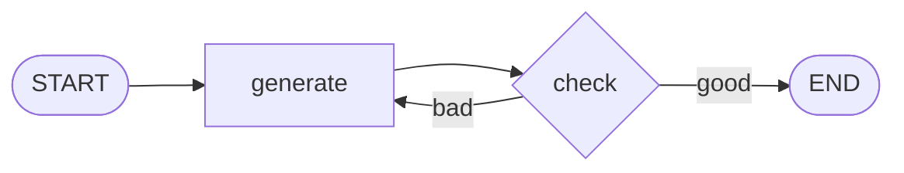

Why it exists: plain LangChain chains are a one-way pipe. Real agents need:

| Need | LangGraph gives |
|---|---|
| Retry / loop until good | Cycles in the graph |
| Choose the next step at runtime | Conditional edges |
| Shared memory between steps | State + reducers |
| Remember across calls, survive crashes | Checkpointers |
| Human approval | `interrupt()` |
| Many agents | Subgraphs |
| Live output | Streaming |

It is **low-level**: it doesn't hide prompts or decide your agent's logic. It is the runtime that runs your graph reliably. It works with or without LangChain.

One line: **LangChain = building blocks (LLMs, prompts, tools, retrievers). LangGraph = the runtime that wires them into a stateful, looping app.**

## Workflow vs agent

**Workflow:** *you* write the path. The LLM fills in steps, but the order is fixed in code.
`input → summarize → translate → output`. Predictable, cheap, easy to test.

**Agent:** the *LLM* chooses the path. It looks at the state, picks the next step or tool, and loops until it decides it's done.
`input → LLM → (tool? → LLM → tool? → ...) → output`. Flexible, but slower, costlier, and can loop.

| | Workflow | Agent |
|---|---|---|
| Who picks the next step | Your code | The LLM |
| Path | Fixed | Decided at runtime |
| Good for | Known steps | Open-ended tasks |
| Risk | Rigid | Loops, cost, surprises |

Rule: use a workflow when you can draw the steps up front. Use an agent only when you can't.

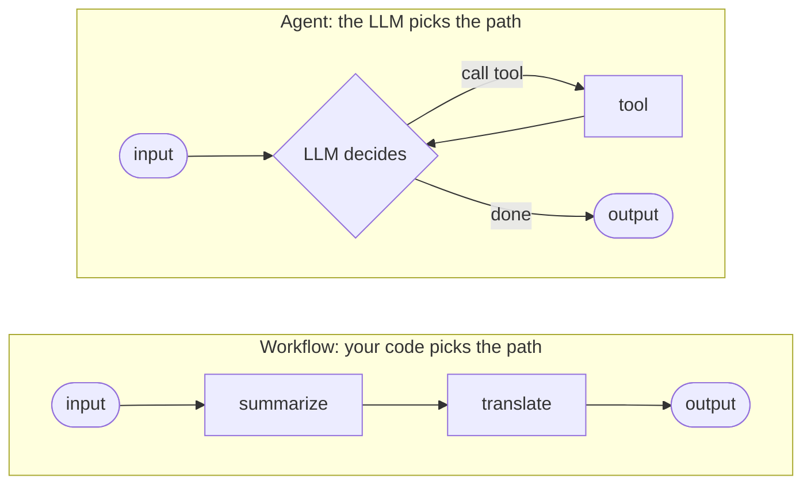

In LangGraph both are the same thing, a graph. A workflow uses fixed edges (`add_edge`). An agent uses a conditional edge where the LLM's output picks the next node (`add_conditional_edges`).

## LLM workflows: the 5 common patterns

An **LLM workflow** is a fixed series of steps where one or more steps call an LLM. Most real apps are one of these 5 patterns (or a mix):

**1. Prompt chaining:** the output of one LLM call is the input to the next.
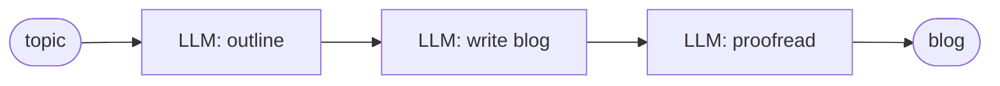
Use when the task splits cleanly into steps. You can add a check between steps.

**2. Routing:** classify the input first, then send it to the right specialist.
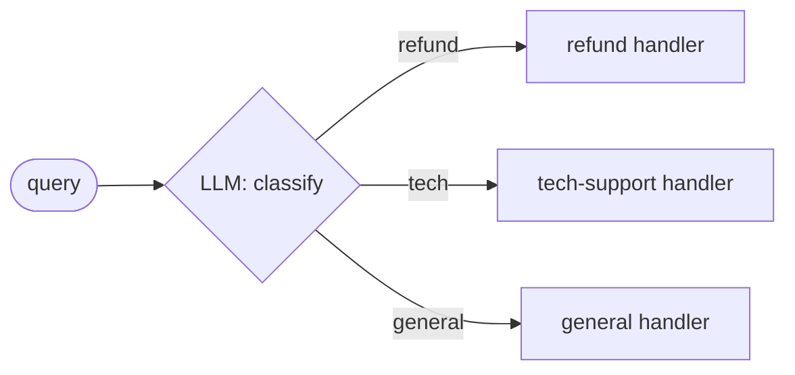
Use when inputs fall into clear types. In LangGraph: a conditional edge.

**3. Parallelization:** run independent LLM calls at the same time, then combine them.
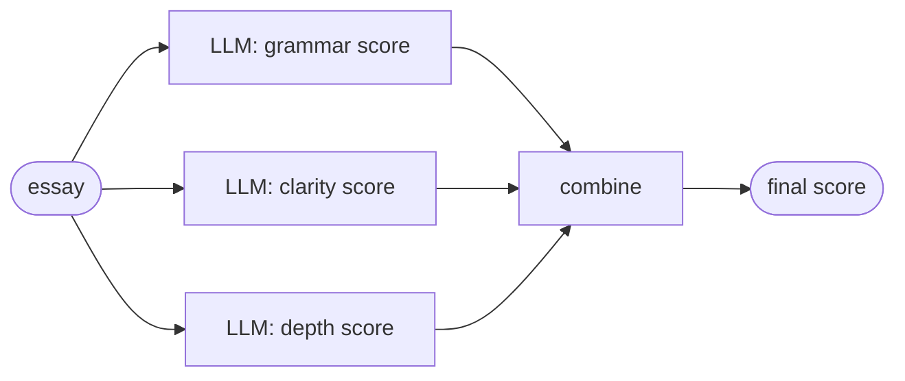
Use for speed, or for several views of the same input (voting). In LangGraph: fan-out edges + a reducer to merge the results.

**4. Orchestrator–worker:** one LLM plans the subtasks at runtime, workers do them, and the results are combined.
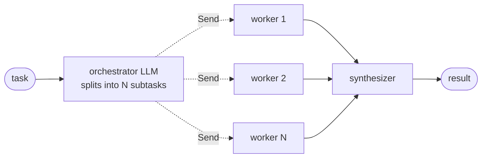
Unlike parallelization, the subtasks are **not known in advance** (e.g. "edit every file that needs a change"). In LangGraph: the `Send` API to spawn workers.

**5. Evaluator–optimizer:** one LLM generates, another critiques, and it loops until it's good enough.
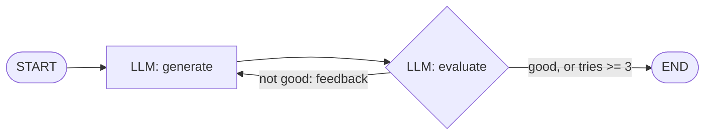
Use when there are clear criteria and iteration helps (writing, translation, SQL fixing). In LangGraph: a loop with a max-iterations guard.

| Pattern | Shape | LangGraph feature |
|---|---|---|
| Prompt chaining | Straight line | `add_edge` |
| Routing | One-of-N branch | `add_conditional_edges` |
| Parallelization | Fan-out / fan-in | Parallel edges + reducer |
| Orchestrator–worker | Dynamic fan-out | `Send` |
| Evaluator–optimizer | Loop | Conditional edge back + limit |

When even these aren't flexible enough (the steps can't be drawn up front), you use an **agent**: an LLM calling tools in a loop and deciding each step.

These patterns are from Anthropic's "Building effective agents" post.

## The 5 patterns in LangGraph code

`llm` is any chat model. The code shows only the graph wiring, so each snippet stays short.

### 1. Prompt chaining

```python
class S(TypedDict):
    topic: str
    outline: str
    blog: str

def make_outline(s): return {"outline": llm.invoke(f"Outline for: {s['topic']}").content}
def write_blog(s):   return {"blog": llm.invoke(f"Write a blog from:\n{s['outline']}").content}

g = StateGraph(S)
g.add_node("outline", make_outline)
g.add_node("write", write_blog)
g.add_edge(START, "outline")
g.add_edge("outline", "write")
g.add_edge("write", END)
```

- **Gate:** add a check between steps (e.g. "is the outline at least 3 points?") with a conditional edge that stops early.
- **Trade-off:** each step is simple and accurate, but latency adds up (N calls in series).

### 2. Routing

```python
def classify(s):
    return {"kind": llm.invoke(f"Answer refund, tech or general: {s['q']}").content.strip()}

g.add_node("classify", classify)
g.add_conditional_edges("classify", lambda s: s["kind"],
                        {"refund": "refund", "tech": "tech", "general": "general"})
```

- Use **structured output** (`llm.with_structured_output(...)` with a fixed set of labels) so the LLM can't return a label you didn't expect.
- A cheap model can do the routing and a strong model can handle the hard branch, which saves cost.

### 3. Parallelization

```python
class S(TypedDict):
    essay: str
    scores: Annotated[list[int], operator.add]   # reducer: merges the parallel writes
    final: float

def grammar(s): return {"scores": [score(s["essay"], "grammar")]}
def clarity(s): return {"scores": [score(s["essay"], "clarity")]}
def depth(s):   return {"scores": [score(s["essay"], "depth")]}
def combine(s): return {"final": sum(s["scores"]) / len(s["scores"])}

for n, fn in [("grammar", grammar), ("clarity", clarity), ("depth", depth)]:
    g.add_node(n, fn)
    g.add_edge(START, n)        # fan-out
    g.add_edge(n, "combine")    # fan-in: combine waits for all three
```

- All three run in the **same super-step**, so the total time ≈ the slowest call, not the sum.
- Without the reducer, two nodes writing `scores` in one step is an error.
- Two kinds: **sectioning** (different subtasks) and **voting** (the same task N times, then a majority or average).

### 4. Orchestrator–worker

```python
from langgraph.types import Send

class S(TypedDict):
    task: str
    subtasks: list[str]
    results: Annotated[list[str], operator.add]
    answer: str

def plan(s):   return {"subtasks": split_into_subtasks(s["task"])}       # LLM decides N
def assign(s): return [Send("worker", {"sub": t}) for t in s["subtasks"]]
def worker(w): return {"results": [llm.invoke(w["sub"]).content]}
def synth(s):  return {"answer": "\n".join(s["results"])}

g.add_node("plan", plan)
g.add_node("worker", worker)
g.add_node("synth", synth)
g.add_edge(START, "plan")
g.add_conditional_edges("plan", assign, ["worker"])   # spawn N workers at runtime
g.add_edge("worker", "synth")
```

- `Send(node, input)` starts one copy of `worker` per subtask, each with **its own small input**, not the full state.
- The difference from #3: there the branches are fixed in the graph; here N is decided by the LLM while running.

### 5. Evaluator–optimizer

```python
class S(TypedDict):
    task: str
    draft: str
    feedback: str
    ok: bool
    tries: int

def generate(s):
    d = llm.invoke(f"{s['task']}\nFix this feedback: {s['feedback']}").content
    return {"draft": d, "tries": s["tries"] + 1}

def evaluate(s):
    v = judge(s["draft"])                 # LLM with structured output: ok + feedback
    return {"ok": v.ok, "feedback": v.feedback}

g.add_edge(START, "generate")
g.add_edge("generate", "evaluate")
g.add_conditional_edges("evaluate",
    lambda s: END if s["ok"] or s["tries"] >= 3 else "generate")

app.invoke({"task": "...", "feedback": "", "tries": 0})
```

- **Always cap the loop** (`tries >= 3`). Otherwise a picky judge loops forever, and the recursion limit throws an error.
- Works only if the evaluator has **clear criteria** (tests pass, the SQL runs, the word count fits).

## State and data points

**State:** the shared memory of one graph run. Every node can read it, and nodes update it as the run moves forward. Think of it as a dict that travels through the graph.

**Data points:** the individual keys inside the state. Each one is a piece of info the workflow needs to remember.

```python
class EssayState(TypedDict):
    essay: str          # data point: the input
    feedback: str       # data point: written by the "review" node
    score: int          # data point: written by the "grade" node
```

- You define the data points up front with a `TypedDict`, so every node agrees on the names and types.
- A node reads the data points it needs and returns only the ones it changed, e.g. `{"score": 8}`.
- Each data point has its own merge rule (override or append, see Reducers below).

So: **state = the container, data points = what's in it.**

### Workflow state: how state moves through a run

The state is passed from node to node. Each node adds or changes its data points, so the state fills up as the workflow runs:

```text
START        {essay: "…", feedback: "",       score: 0}
  ↓ review   returns {feedback: "good flow"}
             {essay: "…", feedback: "good flow", score: 0}
  ↓ grade    returns {score: 8}
             {essay: "…", feedback: "good flow", score: 8}
END          → this final state is what invoke() returns
```

- You start a run by passing the initial state: `app.invoke({"essay": "…", "feedback": "", "score": 0})`. Keys you leave out aren't filled with defaults; they're simply missing until a node writes them.
- Nodes never talk to each other directly. They talk only through the state.
- The state lives for one run. To keep it across runs (e.g. chat history), you need persistence/checkpoints (a later video).

## StateGraph

A graph where every node reads one shared state and returns **only the keys it changes**.

- **State:** one dict (a `TypedDict`) shared by all nodes.
- **Node:** a function `state -> {changed keys}`.
- **Edge:** which node runs next.

## Reducers: how a returned key is merged

A **reducer** is a function `(old_value, new_value) -> merged_value`. A node returns an update like `{"steps": ["b"]}`, and LangGraph calls the reducer of `steps` to merge it into the state. Each key has its own reducer, set in the state definition with `Annotated[type, reducer]`.

- **Override (default):** `answer: str`. No reducer, so the new value replaces the old.
- **Append:** `steps: Annotated[list, operator.add]`. Merged as `old + new`.

```python
class State(TypedDict):
    answer: str                                # override
    steps: Annotated[list[str], operator.add]  # append
```

Classic bug: forget the reducer on a list and each node wipes the history. When two nodes run in parallel and write the same key, you *need* a reducer, or LangGraph raises an error.

### Step by step

```text
state:        {steps: ["a"]}
node returns: {steps: ["b"]}
reducer:      operator.add(["a"], ["b"])  →  ["a", "b"]
new state:    {steps: ["a", "b"]}
```

Without the reducer, the new state would be `{steps: ["b"]}`, and `"a"` is lost.

### Common reducers

| Reducer | Merge | Use for |
|---|---|---|
| none (default) | new replaces old | Current answer, a flag, a counter you set |
| `operator.add` | `old + new` (lists); `old + new` (numbers, so it sums) | Logs, results from parallel workers, totals |
| `add_messages` | Append messages; **replace** a message with the same id | Chat history (`MessagesState` uses it) |
| custom function | anything you write | Dedupe, keep the max, merge dicts |

### Custom reducer

Any function with two arguments works:

```python
def merge_dict(old: dict, new: dict) -> dict:
    return {**old, **new}                       # new keys win

def keep_last_5(old: list, new: list) -> list:
    return (old + new)[-5:]                     # bounded history

class State(TypedDict):
    meta: Annotated[dict, merge_dict]
    recent: Annotated[list[str], keep_last_5]
```

### Chat state with add_messages

```python
from langgraph.graph import MessagesState     # = {"messages": Annotated[list, add_messages]}

def chatbot(s: MessagesState):
    return {"messages": [llm.invoke(s["messages"])]}   # return only the new message
```

### Rules to remember

- A node returns **only the new part**: `{"steps": ["b"]}`, not `{"steps": s["steps"] + ["b"]}`. Doing both duplicates the list: `["a", "a", "b"]`.
- Parallel nodes in the same super-step writing the same key **need** a reducer (error otherwise: `InvalidUpdateError`).
- The reducer also runs on the input you pass to `invoke()`.
- Keep reducers **pure and fast**. They run on every update.
- Distributed-systems link: a reducer is a **merge function**, the same idea as Redux reducers, MapReduce reduce, or a CRDT merge. Order-independent reducers (add to a set, take the max) are safe for parallel writes; with `operator.add` on lists, the order depends on the order the nodes ran in.

## Is LangChain stateless?

Mostly, yes. A LangChain **chain is stateless**.

- Every `chain.invoke(...)` is independent. Data flows through the pipe once and nothing is kept.
- The LLM itself is stateless too. It only "remembers" what you put back into the prompt.

```python
chain = prompt | llm | parser
chain.invoke({"q": "My name is Vivek"})
chain.invoke({"q": "What's my name?"})   # doesn't know
```

Memory in LangChain = you keep the chat history yourself and resend it each call. The old `ConversationBufferMemory` classes did this for you, and they're deprecated now.

Caveat: newer LangChain (v1) builds its agents (`create_agent`) on the LangGraph runtime. Those agents can have state, but the state comes from LangGraph, not from the chain.

## Does LangChain have a key-value store?

Yes, but not a shared **workflow state**.

1. **Dict passed down a chain.** In `prompt | llm | parser`, each step gets the previous step's output. `RunnablePassthrough.assign(x=...)` adds keys to it. Key-value, but it only flows forward in one pipe.
2. **Memory classes.** Chat history only (deprecated).
3. **`BaseStore` / `InMemoryStore`.** A real key-value store (`mset`, `mget`), used for caching embeddings or storing docs. A utility, not workflow state.

## LangChain vs LangGraph: state

| | LangChain chain | LangGraph |
|---|---|---|
| Data flow | Output → next input, one direction | One shared state that every node reads and writes |
| State inside one run | Only the dict in the pipe | Typed state with data points |
| State across runs | None | Yes, with a checkpointer |
| Loops / branches | Hard | Built in (conditional edges) |
| Merge rule per key | None | Reducers (override or append) |

Main reason LangGraph exists: LangChain can store data, but it has no single state that lives through loops, branches and restarts.

## Sequential vs event-driven execution

**Sequential execution (LangChain chains):** steps run in a fixed line, one after another. Step 2 always runs after step 1, and the order is set when you build the chain.

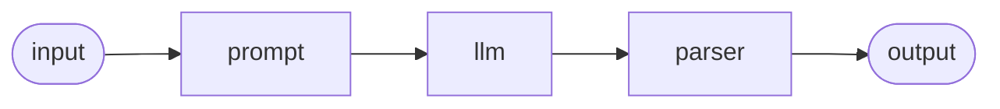

Simple and predictable, but it can't go back (no loops) and it can't decide at runtime which step comes next.

**Event-driven execution (LangGraph):** a node runs *because something happened*, not because it's next in a list. The "event" is a state update: when a node finishes and writes to the state, that message triggers the nodes connected to it.

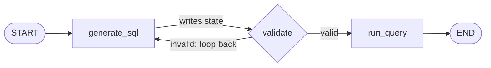

How LangGraph runs it (based on Google's **Pregel** model):

1. Run in **super-steps**. In each step, all nodes that received a message run, possibly in parallel.
2. Their state updates are merged using the reducers.
3. The updates trigger the next set of nodes.
4. The run stops when no node is triggered (it reaches `END`) or the recursion limit is hit.

| | Sequential | Event-driven |
|---|---|---|
| What starts a step | Its position in the chain | A message / state update reaching it |
| Order | Fixed at build time | Decided at runtime |
| Loops | No | Yes |
| Parallel nodes | Only special cases | Natural (same super-step) |
| Used by | LangChain chains | LangGraph |

Note: a "sequential workflow" in LangGraph (START → a → b → END) still runs event-driven. It just happens to have one path.

## Execution model (how a graph actually runs)

### compile()

`graph.compile()` checks the graph (no orphan nodes, edges point to real nodes) and turns it into a **Pregel** app: a runnable object with `invoke`, `stream` and `ainvoke`. You can't run a `StateGraph` before you compile it.

### The pieces inside

- **Channels:** each state key is a *channel*. A channel holds the current value plus its reducer.
- **Nodes = actors:** each node **subscribes** to channels and **writes** to channels.
- **Edges = triggers:** an edge `a → b` means "when `a` finishes, `b` becomes active in the next step".

Nodes never call each other. They only read channels and write channels. This is message passing.

### One super-step = 3 phases

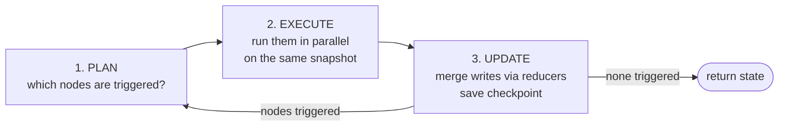

Example: `START → a → (b, c in parallel) → d → END`

| Step | Runs | Sees | After the update |
|---|---|---|---|
| 0 | input | — | input written to the channels |
| 1 | a | input | a's writes applied |
| 2 | b, c together | the state after a | b's and c's writes merged by the reducers |
| 3 | d | the state after b and c | d's writes applied |
| — | nothing triggered | — | stop, return the state |

### Rules that come from this

- **Parallel nodes can't see each other's writes** in the same step. `b` doesn't see `c`'s output. They only meet in the next step.
- **Writes become visible only at the end of the step** (a barrier, like Bulk Synchronous Parallel).
- **A step is all-or-nothing:** if one parallel node fails, none of that step's writes are applied. With a checkpointer, you can resume from the last good step and the nodes that succeeded won't rerun.
- **Fan-in waits:** `d` runs once, after both `b` and `c` have finished.
- **Loops are just more steps.** The **recursion limit** (default 25 steps) stops a graph that never ends, by raising `GraphRecursionError`. Change it with `config={"recursion_limit": 50}`.
- **Uneven branches:** if `b` takes one step and `c` takes two, `d` may run as soon as `b` finishes. Use a node with `defer=True` (or an explicit join) to wait for every branch.

### Streaming = watching the steps

`app.stream(input, stream_mode=...)` emits output as the steps run:

| Mode | Emits |
|---|---|
| `values` | The full state after each step |
| `updates` | Only what each node wrote |
| `messages` | LLM tokens as they're produced |
| `debug` | Everything (tasks, checkpoints) |

### Dist-sys link

| LangGraph | Distributed systems |
|---|---|
| Super-step | BSP superstep (Pregel, Giraph) |
| End-of-step update | A barrier |
| Reducer | Merge function / CRDT |
| Checkpoint per step | Snapshot / write-ahead log |
| Step all-or-nothing | A transaction |

## Checkpoints

A **checkpoint** is a saved snapshot of the state, taken after every super-step. A **checkpointer** is the thing that saves the snapshots (in memory, SQLite, Postgres, Redis…).

This is how LangGraph gets state **across runs**. Without a checkpointer, the state dies when `invoke()` returns.

```python
from langgraph.checkpoint.memory import InMemorySaver

app = graph.compile(checkpointer=InMemorySaver())

cfg = {"configurable": {"thread_id": "user-42"}}
app.invoke({"messages": ["My name is Vivek"]}, cfg)
app.invoke({"messages": ["What's my name?"]}, cfg)   # remembers: same thread
```

- **thread_id** = which conversation. Each thread has its own chain of checkpoints. A new thread_id starts from an empty state.
- Each checkpoint stores: the state values, which nodes run next, and metadata (the step number).

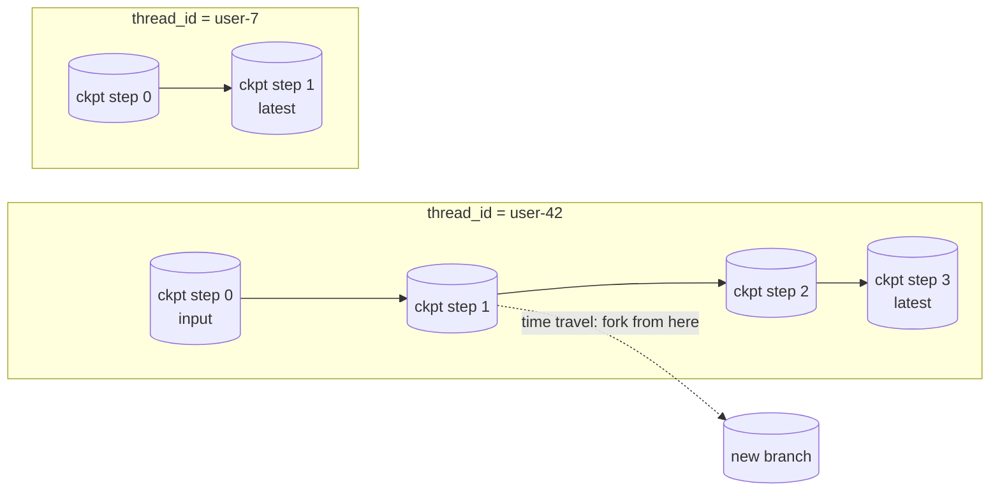

What checkpoints give you:

| Feature | How |
|---|---|
| Memory (chatbots) | The next invoke on the same thread loads the last state |
| Fault tolerance | A crash mid-run resumes from the last checkpoint instead of starting over |
| Human-in-the-loop | Pause before a node (`interrupt`), wait for a human, resume later |
| Time travel | `get_state_history(cfg)` lists old checkpoints, and you can replay or fork from any of them |
| Debugging | `get_state(cfg)` shows the exact state at any point |

Production: `InMemorySaver` is lost on restart and isn't shared between pods. Use `SqliteSaver` locally and `PostgresSaver` behind a FastAPI service on K8s, so any pod can resume any thread.

Dist-sys link: this is the same idea as a write-ahead log / snapshot. Save after each step, and on failure replay from the last good point.

## Human in the loop (HITL)

**HITL** = the graph **pauses** at a point, waits for a human to approve, edit or reject, then **resumes** from the same spot.

Use it before anything risky or irreversible: running SQL on prod, sending an email, a payment, deleting data.

It needs a **checkpointer**. The pause is just "save the state and stop". The resume loads that checkpoint, maybe hours later, maybe on another pod.

```python
from langgraph.types import interrupt, Command

def approve_sql(state):
    decision = interrupt({"sql": state["sql"]})   # pause here, send sql to the human
    return {"approved": decision == "yes"}

app = graph.compile(checkpointer=checkpointer)
cfg = {"configurable": {"thread_id": "t1"}}

app.invoke({"question": "top 5 customers"}, cfg)   # runs, stops at interrupt
# ... show the SQL to the human in the UI ...
app.invoke(Command(resume="yes"), cfg)             # continues with decision = "yes"
```

Flow:

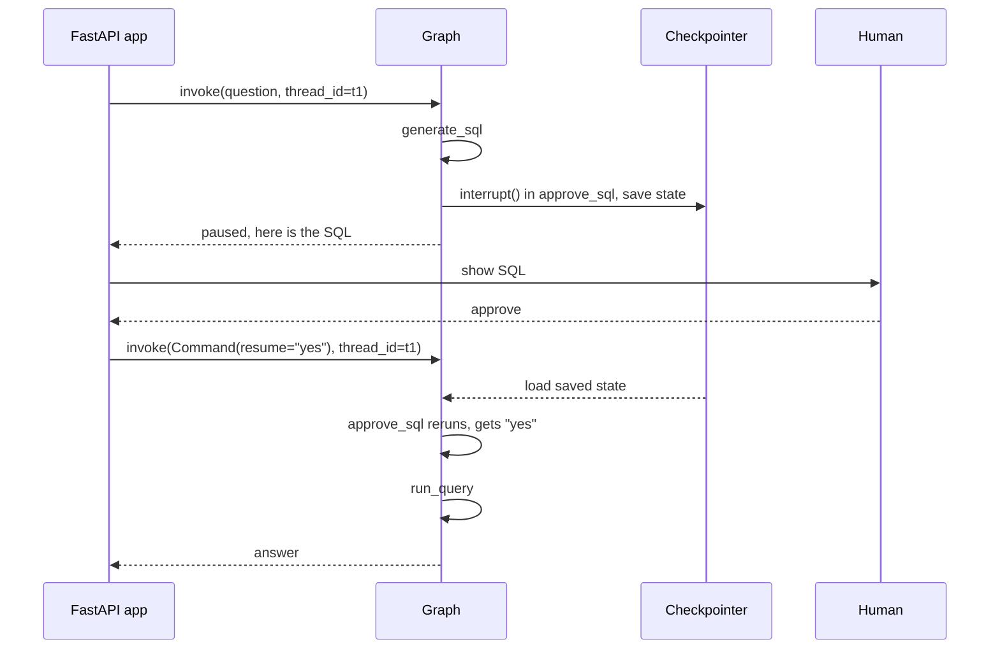

Common patterns:

| Pattern | Human does |
|---|---|
| Approve / reject | Yes or no before an action |
| Edit state | Fix the SQL or the draft, then continue |
| Review tool call | Check the tool name and args before it runs |
| Give input | Answer a question the agent asked |

Gotchas:
- On resume the node **restarts from its beginning**, not from the `interrupt` line. Code before `interrupt()` runs twice, so keep side effects after it (or make them idempotent).
- Same `thread_id` to resume. A different id = a fresh run.
- Older style: `compile(interrupt_before=["run_query"])` pauses before a node without code inside it.

## Subgraphs

A **subgraph** = a compiled graph used as a **node** inside another graph. Like a function call: the parent graph calls it, it runs its own steps, and it returns updates.

Why use one:
- **Multi-agent:** each agent is its own subgraph (SQL agent, RAG agent), and a parent "supervisor" graph routes between them.
- **Reuse:** build "validate + retry SQL" once and plug it in anywhere.
- **Teams / testing:** each subgraph can be built and tested on its own.
- **Private state:** a subgraph can keep scratch keys the parent never sees.

### Way 1: shared keys, added directly as a node

If the parent and child share state keys, just add the compiled subgraph as a node.

```python
class State(TypedDict):
    question: str
    sql: str

sql_agent = sql_builder.compile()        # child graph, also uses question/sql

parent = StateGraph(State)
parent.add_node("sql_agent", sql_agent)  # the whole graph is one node
parent.add_edge(START, "sql_agent")
```

Shared keys flow in and out automatically. Keys only the child has stay inside the child.

### Way 2: different state, called from a node function

If the schemas differ, wrap the subgraph in a node and map the state yourself.

```python
def call_rag(state: ParentState):
    out = rag_graph.invoke({"query": state["question"]})  # parent → child
    return {"context": out["docs"]}                       # child → parent
```

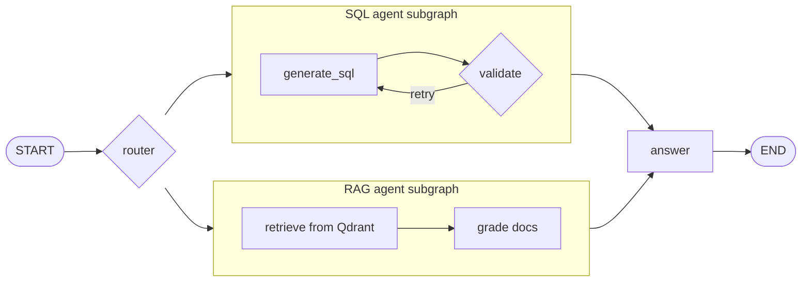

Notes:
- The checkpointer is set on the **parent** only. Subgraphs use it automatically, so HITL `interrupt()` inside a subgraph works.
- Streaming with `subgraphs=True` also shows the events from inside the child graphs.
- Rule: use a subgraph when a part has its own loop or its own state. If it's just one step, a plain node is enough.
